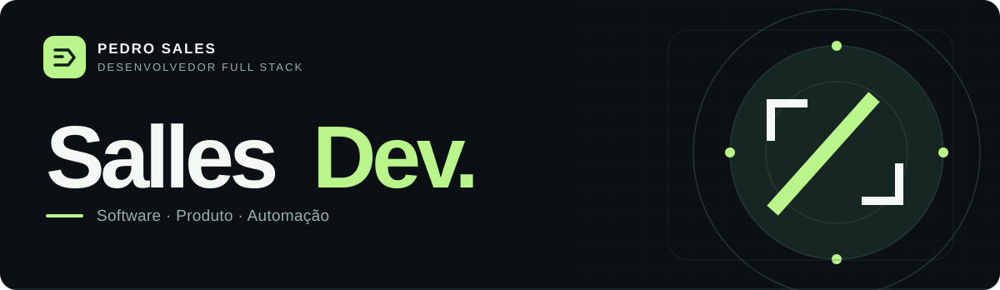

<!-- Perfil de Pedro Sales • identidade Salles Dev -->

  <picture>
    <source media="(prefers-color-scheme: dark)" srcset="./assets/salles-dev-dark.svg">
    <source media="(prefers-color-scheme: light)" srcset="./assets/salles-dev-light.svg">
    
  </picture>

  
<strong>Pedro Sales</strong> · Desenvolvedor Full Stack · São Paulo, Brasil

  
Do problema à interface. Da regra de negócio à produção.

  

    <a href="https://salles.dev.br">Portfólio</a> &nbsp;·&nbsp;
    <a href="https://github.com/xsalles?tab=repositories">Repositórios</a> &nbsp;·&nbsp;
    <a href="https://www.linkedin.com/in/pedro-sales-00090a274/">LinkedIn</a> &nbsp;·&nbsp;
    <a href="mailto:xs.salles@gmail.com">E-mail</a>
  

---

## Prazer, sou o Pedro.

Gosto de pegar problemas que parecem confusos, entender como as pessoas realmente trabalham e transformar isso em software que faz sentido usar.

Minha atuação é **full stack de ponta a ponta**: penso no fluxo, desenho a interface, modelo os dados, construo as APIs, integro serviços, automatizo tarefas e acompanho a evolução do produto. Tenho um cuidado especial com **experiência de uso, arquitetura, acessibilidade e manutenção**.

**Salles Dev** é a identidade que reúne esse jeito de trabalhar: menos complexidade por aparência, mais tecnologia resolvendo problemas reais.

## O que estou construindo

### 01 / [MIRRO](https://github.com/xsalles/mirro)

Um experimento *local-first* de guarda-roupa digital e provador virtual, com reconstrução corporal por múltiplas imagens, visualização 3D e simulação física de tecidos. Um projeto de produto, geometria computacional e engenharia no navegador — sem depender de IA generativa para criar o resultado.

`TypeScript` · `Three.js` · `Web Workers` · `WebAssembly` · `IndexedDB`

### 02 / PlakaLink

Um produto próprio para conectar negócios aos seus clientes por **NFC e QR Code**, com uma experiência simples na ponta e uma operação organizada por trás. Em desenvolvimento.

`Produto` · `Full Stack` · `NFC` · `QR Code`

### 03 / Vitta-One

Sistema de gestão clínica desenvolvido em equipe, cobrindo jornadas de recepção, médicos e pacientes. Meu foco é transformar regras de atendimento, agendas, permissões e fluxos clínicos em uma aplicação consistente.

`React` · `APIs` · `PostgreSQL` · `UX` · `Controle de acesso`

<a href="https://github.com/xsalles?tab=repositories">Explorar outros projetos →</a>

## Tecnologias que uso

**Interfaces & produto** — React, Next.js, Angular, TypeScript, Tailwind CSS, HTML e CSS.

**Back-end & integrações** — Node.js, NestJS, Python, Java, Spring Boot, C#/.NET e APIs REST.

**Dados & infraestrutura** — PostgreSQL, MySQL, Docker, Linux, Git e GitHub Actions.

**Automações & operação** — n8n, webhooks, integrações entre sistemas, processamento de dados e observabilidade.

> A stack muda conforme o problema. Clareza, segurança e qualidade não deveriam mudar.

## Como eu trabalho

**Entender antes de implementar.** O fluxo precisa fazer sentido para quem usa, não só para quem desenvolve.

**Construir com responsabilidade.** Validação, permissões, acessibilidade, tratamento de erros e testes são parte da solução.

**Evoluir sem complicar.** Prefiro decisões que continuem compreensíveis quando o projeto crescer.

## Além do código

Sou formado como técnico em Desenvolvimento de Sistemas pelo SENAI Suíço-Brasileira e curso Sistemas de Informação na Faculdade Impacta. Aprender, experimentar e colocar ideias no mundo faz parte da minha rotina — tanto em projetos pessoais quanto em sistemas utilizados no dia a dia.

---

  
<strong>Tem uma ideia, um projeto ou um problema interessante?</strong>

  
<a href="mailto:xs.salles@gmail.com">Vamos conversar</a> &nbsp;·&nbsp; <a href="https://salles.dev.br">salles.dev.br</a>

  Salles Dev — engenharia com intenção, software com propósito.

